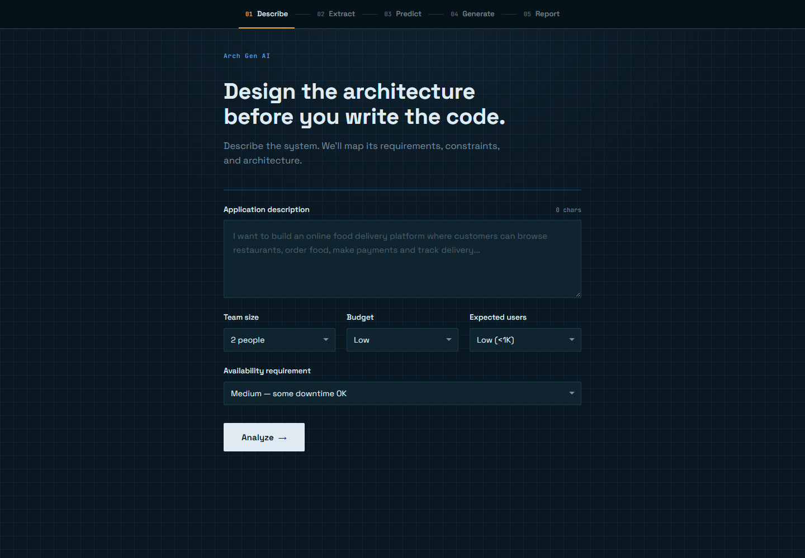
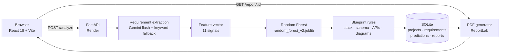

<div align="center">

# ARCH GEN AI

**Describe an application. Get an architecture decision, a complete technical blueprint, and a downloadable PDF report.**

[](https://arch-gen-ai-nu.vercel.app/)
[](https://arch-gen-ai-nu.vercel.app/)
[](https://arch-gen-ai.onrender.com/docs)
[](backend/requirements.txt)
[](backend/app/main.py)
[](frontend/package.json)
[](backend/tests)

[Live app](https://arch-gen-ai-nu.vercel.app/) · [API docs](https://arch-gen-ai.onrender.com/docs) · [Report an issue](https://github.com/le-aditya/arch-gen-ai/issues)

</div>



---

## Why this exists

Architecture decisions are made in the first week and paid for over the next two years. ARCH GEN AI turns a plain-language product description into the artefact a team actually needs before writing code: a defensible architecture recommendation, the factors behind it, a concrete stack, a starter schema and API surface, diagrams, and a report you can attach to a design review.

It is deliberately a **pipeline, not a chat window**. Every recommendation is produced by a trained classifier you can inspect, and every generated artefact is derived by rules you can read:

- the *style* decision (Monolith / Microservices / Serverless) is **learned** from data;
- the *content* of the blueprint is **deterministic**, so the same inputs always produce the same schema, endpoints and diagrams.

## The pipeline

The UI walks through five stages, and each one maps to a distinct backend step.

| # | Screen | What happens |
|---|--------|--------------|
| 01 | **Describe** | Free-text description plus four project inputs: team size, budget, expected users, availability requirement. |
| 02 | **Extract** | Gemini turns the prose into structured requirements — domain, actor roles, modules, real-time, payments, integrations, data complexity. Falls back to a keyword extractor if the LLM is unavailable or returns malformed JSON. |
| 03 | **Predict** | A Random Forest scores the requirements as an 11-feature vector and returns the winning style, its confidence, every class probability, and the five features that drove the decision. |
| 04 | **Generate** | Rule engines turn `{requirements, style, budget}` into a tech stack, a relational schema, a REST API surface, and an architecture + deployment diagram. |
| 05 | **Report** | ReportLab assembles an 11-section PDF, including the two diagrams drawn as vector figures. |

## Architecture



The frontend is a static Vite build; the backend is a single FastAPI service. The only external dependency is Gemini, and the app degrades gracefully without it.

## What the report contains

The downloaded PDF is the deliverable — typically seven pages, not a chat transcript.

| Section | Contents |
|---------|----------|
| Cover | Report ID, generation date, recommended architecture, confidence, classifier version, assessment inputs |
| 01 Project description | The prompt as submitted |
| 02 Extracted requirements | Domain, actors, modules, flags, integrations, data complexity |
| 03 Architecture recommendation | The chosen style, what it implies, and the classifier's score for **all three** options as bars |
| 04 Deciding factors | Top five features with the actual project value, weight as a share of total model importance, and why each one matters |
| 05 Technology stack | Frontend, backend, database, messaging, infrastructure and third-party integrations |
| 06 Architecture diagram | Vector figure: client → gateway → services → data tier |
| 07 Deployment diagram | Vector figure: ingress → runtime tier → data tier |
| 08 Database schema | Up to 14 tables derived from the extracted modules, with PK/FK marked |
| 09 API specification | Core REST endpoints with methods and purpose |
| 10 Model information | Holdout metrics, real-case-study metrics, confusion matrix |
| 11 Assumptions & limitations | What was assumed, what the confidence does and does not mean, next steps |

Reports are regenerated on every download, so a report link always reflects the current generator rather than a stale file.

## Tech stack

| Layer | Choice | Notes |
|-------|--------|-------|
| Frontend | React 18, Vite 5 | No UI framework — a hand-built blueprint design system (Space Grotesk + JetBrains Mono, cyanotype palette). Diagrams are drawn as inline SVG. |
| Backend | FastAPI, Pydantic v2, SQLAlchemy 2 | Typed request/response contracts; SQLite for local persistence. |
| ML | scikit-learn, pandas, joblib | Random Forest, artifacts committed so deployment needs no training step. |
| LLM | Google Gemini (`gemini-flash-latest`) | Structured JSON extraction, with a deterministic keyword extractor as fallback. |
| Reporting | ReportLab | Diagrams are rendered as vector primitives, not raster images. |
| Hosting | Vercel (frontend) · Render (backend) | `vercel.json` and `render.yaml` are checked in. |

## The model

**11 features, all knowable before the first line of code:** team size, budget, expected users, number of actor roles, number of modules, real-time requirement, payment requirement, number of external integrations, data complexity, availability requirement, domain.

**Training data:** 1,200 generated projects (960 train / 240 held out) plus 35 hand-labelled real-world case studies used as an out-of-distribution check. Labels come from a feature-utility score with small noise, balanced across the three classes.

**Estimator:** `RandomForestClassifier(n_estimators=300, max_depth=12, min_samples_leaf=2, class_weight="balanced", random_state=42)`.

| Metric | Holdout (n=240) | Real case studies (n=35) |
|--------|----------------|--------------------------|
| Accuracy | 88.8% | 82.9% |
| Precision (weighted) | 89.2% | 86.8% |
| Recall (weighted) | 88.8% | 78.5% |
| F1 (weighted) | 88.8% | 78.6% |

Per-class recall on the real cases is uneven: Microservices 100%, Monolith 44%, Serverless 91%. The model over-predicts Microservices for genuinely small projects, which is why the report shows all three class probabilities and an explicit caveat rather than a single confident verdict.

Retrain or re-evaluate after changing the data:

```bash
cd backend
python ml/src/train.py      # rewrites ml/models/*.joblib and ml/model_metrics.json
python ml/src/evaluate.py   # recomputes held-out + real-case metrics
```

## API

Base URL: `https://arch-gen-ai.onrender.com` · interactive docs at `/docs`.

| Method | Path | Purpose |
|--------|------|---------|
| `GET` | `/health` | Liveness probe used by Render |
| `POST` | `/analyze` | Full pipeline: extract → predict → generate → persist, returns everything the UI needs plus a `report_id` |
| `POST` | `/extract-requirements` | Requirement extraction only |
| `POST` | `/predict-architecture` | Classifier only, from a feature vector |
| `POST` | `/generate-architecture` | Blueprint only, from requirements + prediction |
| `GET` | `/report/{report_id}` | Renders and streams the PDF |

```bash
curl -X POST https://arch-gen-ai.onrender.com/analyze \
  -H "Content-Type: application/json" \
  -d '{
    "description": "An online learning platform where students enroll in courses, watch video lectures, take quizzes and track progress.",
    "team_size": 4,
    "budget": "low",
    "expected_users": "medium",
    "availability": "low"
  }'
```

```jsonc
{
  "project_id": 1,
  "report_id": "rpt_825819e46f",
  "prediction": {
    "architecture": "Microservices",
    "confidence": 0.83,
    "top_factors": [{ "name": "Number of modules", "importance": 0.177 }],
    "alternatives": [
      { "architecture": "Microservices", "probability": 0.83 },
      { "architecture": "Monolith", "probability": 0.12 },
      { "architecture": "Serverless", "probability": 0.05 }
    ]
  },
  "requirements": {
    "domain": "online_education",
    "actors": ["student", "instructor"],
    "modules": ["course_management", "video_streaming", "payment_processing"],
    "real_time": false,
    "payment": true,
    "external_integrations": ["payment_gateway"],
    "data_complexity": "medium"
  },
  "tech_stack": { "frontend": ["React"], "backend": ["FastAPI"] },
  "database": { "tables": [{ "name": "Course", "columns": ["course_id PK", "title"] }] },
  "apis": [{ "method": "GET", "path": "/api/courses", "purpose": "List all courses" }],
  "diagrams": {
    "architecture": {
      "caption": "Microservices — 5 services behind an API gateway",
      "nodes": [{ "id": "gateway", "label": "API Gateway", "kind": "gateway" }],
      "edges": [{ "source": "user", "target": "gateway" }]
    },
    "deployment": { "nodes": [], "edges": [] }
  },
  "created_at": "2026-10-21T10:19:00+00:00"
}
```

## Project layout

```text
arch-gen-ai/
├── backend/
│   ├── app/
│   │   ├── main.py                  # FastAPI app, CORS, router wiring
│   │   ├── routes/                  # analyze, requirements, prediction, generation, reports
│   │   ├── schemas/schemas.py       # Pydantic contracts for the whole pipeline
│   │   ├── models/orm.py            # Project, Requirement, Prediction, Report
│   │   ├── database/db.py           # SQLite engine + session
│   │   └── services/
│   │       ├── llm_service.py       # Gemini provider + keyword fallback
│   │       ├── feature_service.py   # requirements → 11-feature vector
│   │       ├── ml_service.py        # model loading, prediction, importances
│   │       ├── architecture_service.py  # stack, schema, API rules
│   │       ├── diagram_service.py   # node/edge graphs
│   │       ├── pdf_diagram.py       # vector rendering of those graphs
│   │       └── report_service.py    # the PDF report
│   ├── ml/
│   │   ├── src/                     # preprocess, train, evaluate, synthetic data generator
│   │   ├── models/                  # committed .joblib artifacts
│   │   ├── data/                    # synthetic dataset + real case studies
│   │   └── model_metrics.json
│   └── tests/                       # 11 pytest tests
├── frontend/src/
│   ├── App.jsx                      # 5-stage state machine
│   ├── components/                  # Screen1Input … Screen5Report, PipelineNav
│   ├── services/api.js              # fetch wrapper (VITE_API_URL)
│   └── index.css                    # design tokens
├── reports/                         # generated PDFs (gitignored)
├── render.yaml                      # Render blueprint
├── vercel.json                      # Vercel build config
└── start-demo.bat / stop-demo.bat   # one-click Windows demo
```

## Run it locally

**Prerequisites:** Python 3.12+, Node 18+.

### 1. Backend

```bash
cd backend
python -m venv .venv
source .venv/Scripts/activate        # Windows Git Bash
# source .venv/bin/activate          # macOS / Linux
pip install -r requirements.txt
```

Create `backend/.env`:

```dotenv
GEMINI_API_KEY=your_key_here         # optional — omit to use the keyword extractor
ALLOWED_ORIGINS=http://localhost:5173
```

```bash
python -m uvicorn app.main:app --reload --port 8000
```

API at `http://127.0.0.1:8000`, docs at `/docs`.

### 2. Frontend

```bash
cd frontend
npm install
npm run dev
```

Open `http://localhost:5173`. In dev, Vite proxies `/api/*` to `http://127.0.0.1:8000` and strips the prefix, so `/api/analyze` reaches `/analyze`.

### 3. One-click (Windows)

Run `start-demo.bat` — it starts both servers, waits, checks `/health`, and opens the browser. `stop-demo.bat` shuts them down.

### Environment variables

| Where | Variable | Required | Purpose |
|-------|----------|----------|---------|
| Backend | `GEMINI_API_KEY` | No | Enables Gemini requirement extraction; without it the keyword extractor is used |
| Backend | `ALLOWED_ORIGINS` | No | Comma-separated extra CORS origins beyond the localhost defaults |
| Frontend | `VITE_API_URL` | Prod only | Backend base URL, e.g. `https://arch-gen-ai.onrender.com`. Defaults to `/api` |

## Deployment

### Frontend — Vercel

- Import the repo; `vercel.json` sets the install/build commands and `frontend/dist` as the output directory.
- Add `VITE_API_URL=https://arch-gen-ai.onrender.com` in **Project → Settings → Environment Variables**.
- Vite inlines that value at **build time** — redeploy after changing it.

Live: <https://arch-gen-ai-nu.vercel.app/>

### Backend — Render

`render.yaml` provisions a Python web service:

```yaml
rootDir: backend
buildCommand: pip install -r requirements.txt
startCommand: uvicorn app.main:app --host 0.0.0.0 --port $PORT
healthCheckPath: /health
```

- Set `GEMINI_API_KEY` and `ALLOWED_ORIGINS=https://arch-gen-ai-nu.vercel.app` in the dashboard (`sync: false` means Render prompts for them).
- The free instance sleeps when idle; the first request after a pause can take 30–60 s.

Live API: <https://arch-gen-ai.onrender.com/docs>

## Tests

```bash
cd backend
python -m pytest -q
```

```text
11 passed
```

Coverage is concentrated where the pipeline can silently produce wrong artefacts:

- `test_ml_service.py` — prediction shape, confidence bounds, unseen-domain handling.
- `test_feature_service.py` — requirements → feature vector mapping.
- `test_api_analyze.py` — end-to-end `/analyze`, validation errors, PDF download contract.
- `test_report.py` — decodes the generated PDF and asserts that deciding factors carry values, all three class probabilities appear, both diagrams contain real drawing operations, schema foreign keys never point at missing tables, and microservice names come from modules rather than actor tables.

## Limits and trade-offs

- **One style per project.** The output is a single recommendation plus probabilities, not a costed comparison of three designs.
- **The report is guidance, not an estimate.** No timelines, vendor pricing or team velocity modelling.
- **Synthetic training data.** 88.8% holdout accuracy is measured against generated labels; the 35 real case studies are the honest reference point, and Monolith recall on them is weak.
- **Requirement extraction is non-deterministic.** Gemini can return slightly different module lists for the same prompt, which moves the confidence between runs. The classifier itself is deterministic for a given feature vector.
- **SQLite on local disk.** Report rows live in `backend/arch_gen.db` and PDFs in `reports/`. On an ephemeral host a redeploy wipes history, so old report links stop resolving. Swap in Postgres and object storage before treating this as multi-tenant infrastructure.
- **No authentication.** Anyone with a report ID can download that report; IDs are random but not secret.

## Roadmap

- Persist predictions (including factors) so historical reports never need recomputation.
- Compare all three architectures side by side with cost and operational load.
- Export the blueprint as Terraform / docker-compose scaffolding.

---

<div align="center">
<sub>Built by <a href="https://github.com/le-aditya">Aditya Ajay</a> · FastAPI · React · scikit-learn · ReportLab</sub>
</div>
